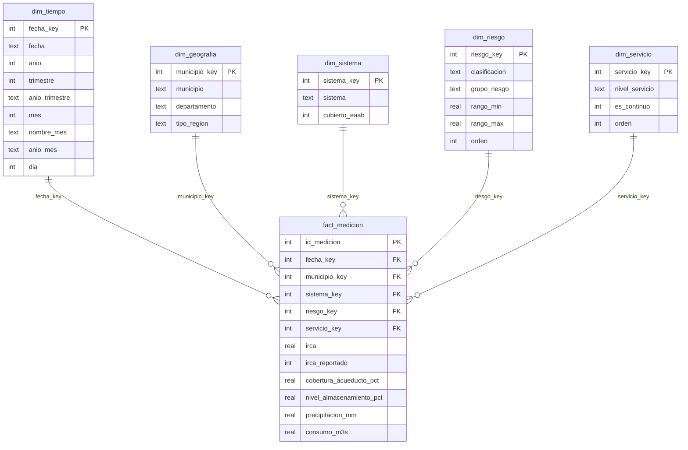

# Etapa 5 - Modelo multidimensional (modelo estrella)

Responsable: Diego Armando Guzmán Garzón.
Archivos: `etapa5/sql/01_crear_modelo.sql`, `etapa5/cargar_modelo.py`, `etapa5/sql/02_validaciones.sql`
y la base `etapa5/calidad_agua_dw.db`.

## 1. Datos de partida

- **Origen:** `datos/dataset_calidad_agua_limpio.csv`, resultado del tratamiento con SSIS de la etapa 3
  (12.989 registros recibidos, 62 duplicados descartados, 247 enviados a revisión).
- **Registros usados:** 12.680 mediciones de 29 municipios entre el 2019-01-01 y el 2025-12-31.
- **Unidad de análisis:** una medición diaria de la calidad y el servicio de agua de un municipio.
- **Granularidad de la tabla de hechos:** una fila por **fecha + municipio**. Se comprobó que en el
  CSV no hay dos filas con la misma fecha y el mismo municipio, así que la unidad de análisis y la
  granularidad coinciden: cada fila de `fact_medicion` es exactamente una medición.

**Limitaciones de calidad que siguen presentes:**

| Problema | Cómo se maneja en el modelo |
|---|---|
| 262 mediciones sin IRCA (2,07 %) | `irca` queda vacío (NULL, no 0) y la medición va al miembro "Sin dato de IRCA" de `dim_riesgo` |
| 620 mediciones sin precipitación | `precipitacion_mm` queda vacío (NULL) |
| 29 filas con @ en lugar de A en el municipio | La carga reemplaza @ por A; quedan 29 municipios en lugar de 47 |
| Latitud y longitud cambian día a día dentro del mismo municipio | No se usan como atributo de la dimensión geográfica |
| Racionado y Sin servicio solo existen en 2024-2025 y en Regional | Se tiene en cuenta al comparar periodos y regiones |
| Datos sintéticos | Los resultados describen este conjunto de datos, no el sistema real |

## 2. Herramienta

Se usa **SQLite** porque la base es un solo archivo que va en el repositorio, Flask la consulta con
el módulo `sqlite3` que ya trae Python (no hay que instalar nada) y funciona igual en la aplicación
publicada. SQL Server, usado en la etapa 3, no se puede consultar desde la aplicación en internet.
La carga se hace con un script de Python para que sea reproducible.

## 3. Diagrama del modelo estrella



Cada dimensión se une a la tabla de hechos con **una sola relación de uno a varios**. Como cada
dimensión tiene una fila por clave, las uniones no multiplican las mediciones.

## 4. Tabla de hechos

| | |
|---|---|
| **Nombre** | `fact_medicion` |
| **Propósito** | Registrar cada medición diaria de calidad y servicio de agua de un municipio para analizarla por tiempo, territorio, sistema de abastecimiento, nivel de riesgo y nivel de servicio |
| **Granularidad** | Una fila por fecha + municipio (`UNIQUE (fecha_key, municipio_key)`) |
| **Filas** | 12.680 |
| **Clave primaria** | `id_medicion` |
| **Claves foráneas** | `fecha_key`, `municipio_key`, `sistema_key`, `riesgo_key`, `servicio_key` |

## 5. Dimensiones (diccionario)

| Dimensión | Clave | Atributos | Filas | Por qué es una perspectiva real |
|---|---|---|---|---|
| `dim_tiempo` | `fecha_key` (AAAAMMDD) | fecha, anio, trimestre, anio_trimestre, mes, nombre_mes, anio_mes, dia | 2.557 + Desconocido | Permite ver la evolución y comparar periodos (por ejemplo, el racionamiento de 2024-2025) |
| `dim_geografia` | `municipio_key` | municipio, departamento, tipo_region | 29 + Desconocido | El riesgo y el servicio cambian según el territorio (Regional frente a Nacional) |
| `dim_sistema` | `sistema_key` | sistema, cubierto_eaab | 4 + Desconocido | Chingaza, Sur y Tibitoc abastecen a Bogotá y la Sabana; el resto queda fuera de la EAAB |
| `dim_riesgo` | `riesgo_key` | clasificacion, grupo_riesgo, rango_min, rango_max, orden | 5 + Sin dato + Desconocido | Es la forma de leer la calidad del agua según el IRCA |
| `dim_servicio` | `servicio_key` | nivel_servicio, es_continuo, orden | 4 + Desconocido | Mide la disponibilidad del agua (continuo, intermitente, racionado, sin servicio) |

**Faltantes frente a desconocidos:** cada dimensión tiene un miembro con clave 0, "Desconocido",
para una categoría que no se reconozca. En `dim_riesgo`, el miembro 6, "Sin dato de IRCA", es
distinto: representa un valor faltante (la medición existe pero no se reportó el IRCA). En la
carga actual hay 262 mediciones "Sin dato de IRCA" y 0 desconocidas.

## 6. Jerarquías

| Jerarquía | Niveles | Por qué la agrupación es válida |
|---|---|---|
| Tiempo | anio → trimestre (anio_trimestre) → mes (anio_mes) → dia | Cada día está en un solo mes, cada mes en un solo trimestre y cada trimestre en un solo año |
| Geografía | tipo_region → departamento → municipio | Se comprobó que cada municipio está en un solo departamento y cada departamento en una sola región (2 regiones, 21 departamentos, 29 municipios) |
| Riesgo | grupo_riesgo → clasificacion | Cada clasificación del IRCA pertenece a un solo grupo (por ejemplo, Alto riesgo e Inviable forman "Alto o inviable") |

## 7. Medidas

| Medida | Significado | Unidad | Fórmula (SQL) | Agregación | ¿Se puede sumar entre grupos? |
|---|---|---|---|---|---|
| Mediciones | Número de mediciones | mediciones | `COUNT(*)` | Conteo | Sí, es aditiva |
| Municipios | Municipios distintos con mediciones | municipios | `COUNT(DISTINCT municipio_key)` | Conteo distinto | No: un municipio aparece en varios grupos; se recalcula en cada nivel |
| IRCA promedio | Calidad promedio del agua (a mayor valor, peor) | puntos de 0 a 100 | `AVG(irca)` (ignora los vacíos) | Promedio | No: se recalcula con las mediciones del grupo, nunca se promedian promedios |
| % riesgo alto o inviable | Parte de las mediciones con IRCA en riesgo alto o inviable | % | `100 * SUM(grupo_riesgo = 'Alto o inviable') / SUM(irca_reportado)` | Proporción | No: se recalcula con su denominador (mediciones con IRCA) |
| % servicio continuo | Parte de las mediciones con servicio continuo | % | `100 * AVG(es_continuo)` | Proporción | No: se recalcula con su denominador (todas las mediciones del grupo) |
| Cobertura promedio | Cobertura de acueducto promedio | % | `AVG(cobertura_acueducto_pct)` | Promedio | No: se recalcula |

## 8. Correspondencia entre el CSV y el modelo

| Columna del CSV | Campo del modelo | Transformación |
|---|---|---|
| fecha | `dim_tiempo.fecha`, `fact_medicion.fecha_key` | La clave es la fecha como número AAAAMMDD; de la fecha se calculan año, trimestre, mes, nombre del mes y día |
| anio, mes, periodo | `dim_tiempo` | No se cargan directamente: se recalculan desde la fecha para que la jerarquía sea coherente |
| municipio | `dim_geografia.municipio`, `fact_medicion.municipio_key` | Se reemplaza @ por A y se quitan espacios |
| departamento, tipo_region | `dim_geografia` | Sin cambios |
| latitud, longitud | (no se cargan) | Cambian día a día dentro del mismo municipio |
| sistema_abastecimiento | `dim_sistema.sistema`, `fact_medicion.sistema_key` | Se agrega `cubierto_eaab` (0 para "Fuera de cobertura EAAB") |
| clasificacion_riesgo | `dim_riesgo.clasificacion`, `fact_medicion.riesgo_key` | Si está vacía porque no se reportó el IRCA, se asigna "Sin dato de IRCA" |
| nivel_servicio | `dim_servicio.nivel_servicio`, `fact_medicion.servicio_key` | Se agrega `es_continuo` |
| irca | `fact_medicion.irca` | Vacío se guarda como NULL, no como 0 |
| irca_reportado | `fact_medicion.irca_reportado` | "Si" → 1, "No" → 0 |
| cobertura_acueducto_pct, nivel_almacenamiento_pct, precipitacion_mm, consumo_m3s | `fact_medicion` | Vacío se guarda como NULL |
| afluencias_m3s, temperatura_c, decision_racionamiento | (no se cargan) | No se usan en las preguntas de esta etapa |

## 9. Procedimiento de carga

Desde la carpeta del proyecto:

```
python etapa5/cargar_modelo.py
```

1. Lee `datos/dataset_calidad_agua_limpio.csv`.
2. Borra la base si existe y ejecuta `sql/01_crear_modelo.sql` (crea las tablas, las claves y los
   miembros fijos de `dim_riesgo`, `dim_servicio` y los "Desconocido").
3. Carga `dim_tiempo`, `dim_geografia` y `dim_sistema` con los valores distintos del CSV.
4. Carga `fact_medicion` buscando la clave de cada dimensión.
5. Imprime las comprobaciones contra el CSV.

## 10. Validaciones y comparación con el CSV

Consultas en `etapa5/sql/02_validaciones.sql`. Resultados de la carga final:

| Comprobación | CSV | Modelo | Resultado |
|---|---|---|---|
| Registros | 12.680 | 12.680 | Coincide |
| Mediciones con IRCA | 12.418 | 12.418 | Coincide |
| IRCA promedio | 14,43 | 14,43 | Coincide |
| Mediciones Regional / Nacional | 7.606 / 5.074 | 7.606 / 5.074 | Coincide |
| Municipios (con @ corregida) | 29 | 29 | Coincide |
| Registros por año | 1.809 a 1.814 | 1.809 a 1.814 | Coincide |

| Validación | Resultado |
|---|---|
| Claves repetidas en las dimensiones | 0 |
| Claves foráneas sin dimensión | 0 |
| Fecha + municipio repetidos en hechos | 0 |
| Mediciones "Sin dato de IRCA" (faltante) | 262 |
| Mediciones con categoría desconocida | 0 |

**Diferencias explicadas:** el CSV tiene 47 nombres de municipio distintos y el modelo 29, porque
18 nombres tenían @ en lugar de A (por ejemplo SO@CH@ y SOACHA). Al corregirlos, ambos dan 29.

**Coherencia con la etapa 4:** el modelo reproduce los resultados del informe de Power BI:
riesgo alto o inviable de 46,42 % en Nacional y 0 % en Regional, y servicio continuo de 47,19 % en
2024.
